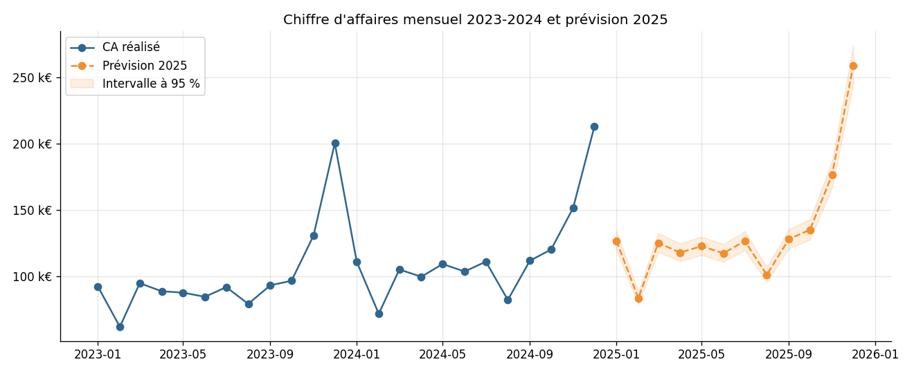
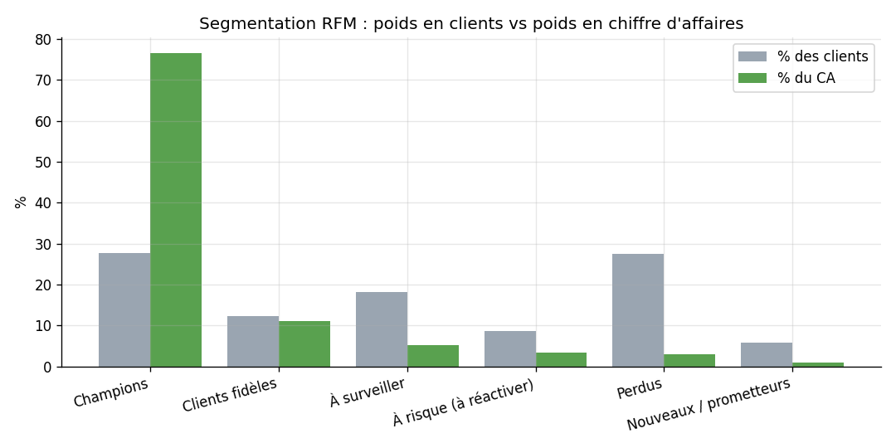
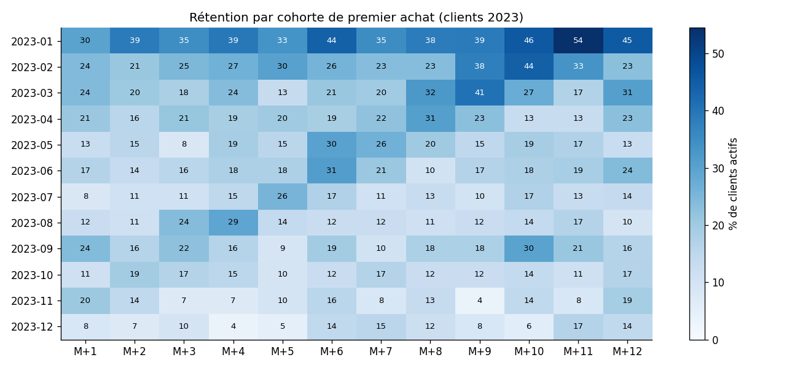

# 🛒 Analyse des ventes e-commerce – Entrepôt SQL, RFM, cohortes et prévision


> Données couvrant **janvier 2023 – décembre 2024** (jeu de données synthétique reproductible)

Analyse complète de l'activité d'un site e-commerce français sur deux ans :
de l'ETL des fichiers bruts jusqu'à un **tableau de bord** et des **recommandations**,
en passant par un **entrepôt de données en étoile**, des **requêtes SQL analytiques**,
une **segmentation RFM**, une **analyse de cohortes** et une **prévision du chiffre d'affaires 2025**.

---

## 🎯 Questions métier

1. Comment ont évolué le chiffre d'affaires, la marge et le panier moyen entre 2023 et 2024 ?
2. Quelles catégories et quels produits portent la croissance ? Où sont les retours ?
3. Qui sont nos meilleurs clients et lesquels sommes-nous en train de perdre ?
4. Combien de clients reviennent après leur premier achat ?
5. Quel chiffre d'affaires attendre en 2025, mois par mois ?

## 📌 Résultats clés

| Indicateur | Valeur |
|---|---|
| Chiffre d'affaires 2024 | **1,39 M€** (+15,6 % vs 2023) |
| Marge brute | 32,9 % |
| Panier moyen | 123 € |
| Clients « Champions » | 28 % des clients → **77 % du CA** |
| Prévision 2025 | **1,62 M€** (erreur de validation : 5,9 %) |



| Segmentation RFM | Rétention par cohorte |
|---|---|
|  |  |

➡️ Rapport complet : **[reports/rapport.md](reports/rapport.md)** ·
Tableau de bord : **[reports/dashboard.html](reports/dashboard.html)** (à télécharger et ouvrir dans un navigateur)

## 🧱 Architecture

```
 Fichiers CSV bruts ──► ETL Python ──► Entrepôt SQLite ──► SQL analytique ──► Python (RFM, cohortes, prévision)
 (clients, produits,     nettoyage      schéma en étoile     CTE, RANK, NTILE,        │
  lignes de commande)    + contrôles    + vue v_sales        agrégations              ▼
                                                                         Rapport Markdown + Dashboard HTML
```

**Modèle de données (schéma en étoile)**

```
               dim_date
                  │
 dim_customer ── fact_sales ── dim_product
```

| Table | Contenu |
|---|---|
| `fact_sales` | 1 ligne par article commandé : quantité, prix, remise, montant net, marge, statut |
| `dim_date` | calendrier (année, trimestre, mois, jour de semaine, week-end) |
| `dim_customer` | ville, région, tranche d'âge, canal d'acquisition |
| `dim_product` | catégorie, prix et coût unitaires |

## 🔧 Étapes

| Étape | Fichier | Détail |
|---|---|---|
| Données | `src/sales/data_generation.py` | ~38 000 lignes de commande réalistes (tendance, saisonnalité, soldes, Black Friday) |
| ETL | `src/sales/etl.py` | Doublons, dates `JJ/MM/AAAA`, décimales à virgule, quantités négatives, villes manquantes, intégrité référentielle |
| Entrepôt | `sql/schema.sql` | Tables, clés, contraintes `CHECK`, index, vue `v_sales` |
| SQL | `sql/analytics.sql` | KPI annuels, CA mensuel, croissance par catégorie, top produits (`RANK`), retours, régions, canaux, RFM (`NTILE`), cohortes |
| Analyses | `src/sales/analysis.py` | Segments RFM, matrice de rétention, prévision (régression tendance + saisonnalité, validation sur 6 mois) |
| Restitution | `src/sales/viz.py`, `src/sales/reporting.py` | 6 graphiques, rapport Markdown, tableau de bord HTML autonome |

## 💡 Recommandations

1. **Programme de fidélité** pour les « Champions » : 28 % des clients mais 77 % du chiffre d'affaires.
2. **Réduire les retours en Mode** (11,7 % des articles) : guide des tailles, photos, avis clients.
3. **Accélérer sur la Beauté**, catégorie la plus dynamique (+25 %) et la plus rentable (52 % de marge).
4. **Préparer novembre-décembre** : ces deux mois concentrent le pic d'activité prévu en 2025.
5. **Campagne de réactivation** ciblée sur les clients « à risque ».

## 🚀 Lancer le projet

```bash
git clone https://github.com/Khadija-ibisk/ecommerce-sales-analytics.git
cd ecommerce-sales-analytics
python -m venv .venv
# Windows : .venv\Scripts\activate   |   macOS/Linux : source .venv/bin/activate
pip install -r requirements.txt

python run_pipeline.py   # ETL + entrepôt + analyses + rapports (quelques secondes)
pytest -v                # 13 tests
```

L'entrepôt `data/processed/warehouse.db` peut ensuite être interrogé avec n'importe quel client SQL
(DB Browser for SQLite, DBeaver, VS Code…).

## 📁 Structure

```
ecommerce-sales-analytics/
├── .github/workflows/ci.yml
├── data/               # raw/ et processed/ (générés)
├── reports/            # rapport.md, dashboard.html, metrics.json, figures/
├── sql/                # schema.sql (entrepôt) et analytics.sql (requêtes)
├── src/sales/          # code du pipeline
├── tests/              # tests pytest
├── run_pipeline.py
└── requirements.txt
```

## 🛠️ Compétences

`SQL (modélisation en étoile, CTE, fonctions de fenêtrage)` · `ETL` · `qualité des données` · `Python` ·
`pandas` · `NumPy` · `scikit-learn` · `séries temporelles` · `segmentation RFM` · `analyse de cohortes` ·
`matplotlib` · `data storytelling` · `tests (pytest)` · `CI (GitHub Actions)`

## 📝 Données

Les données sont **synthétiques** et générées avec une graine fixe (résultats reproductibles).
Elles reproduisent la structure et les comportements d'un vrai site e-commerce sans aucune donnée personnelle.

## 📄 Licence

MIT – voir [LICENSE](LICENSE).
