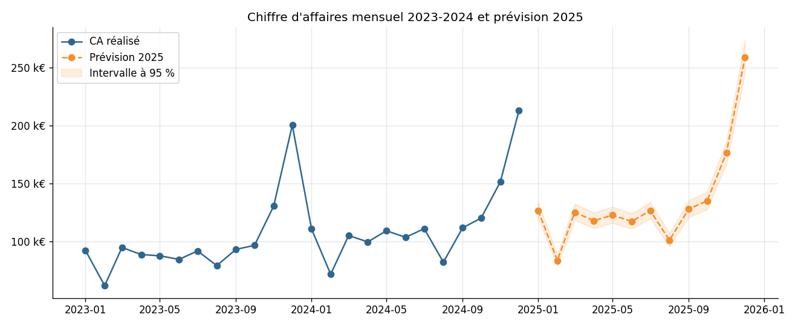
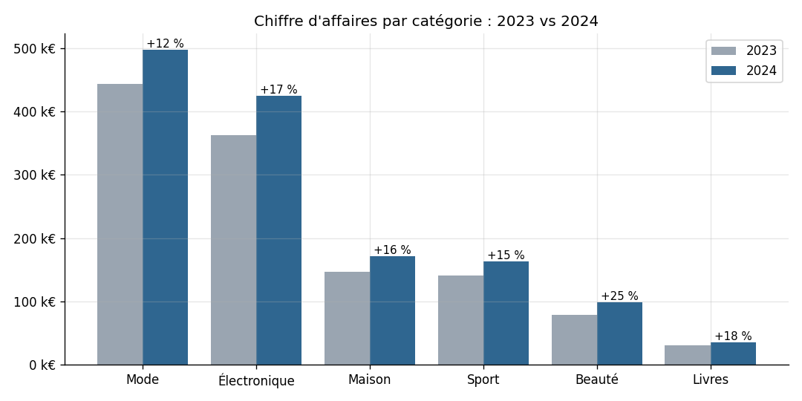
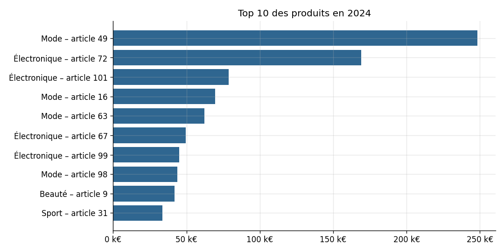
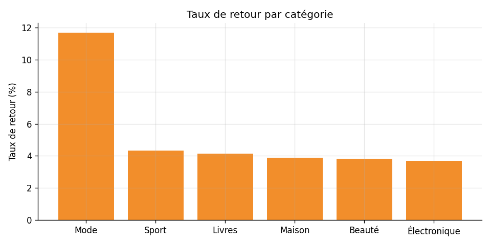
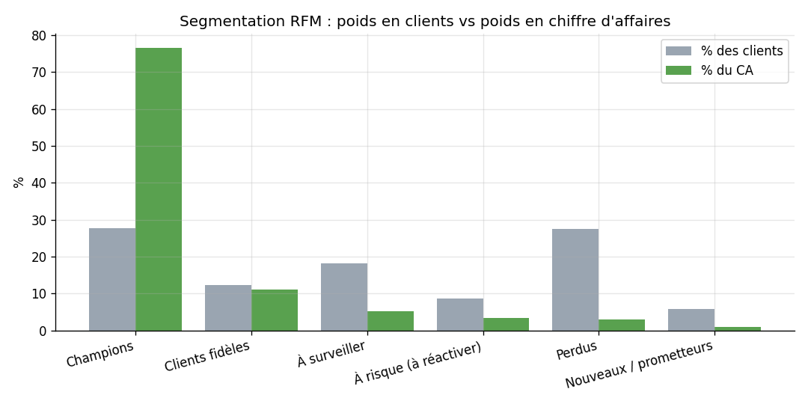
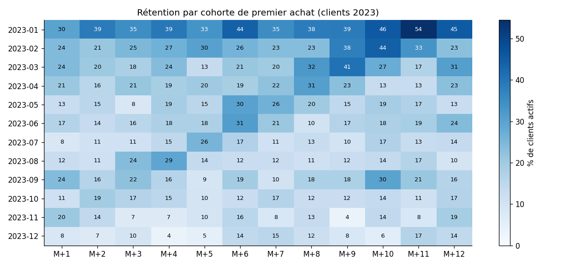

# Rapport d'analyse des ventes e-commerce 2023-2024

_Édité le 11 novembre 2026 – données du 1er janvier 2023 au 31 décembre 2024._

## 1. Synthèse

- Chiffre d'affaires 2024 : **1 391 181 €** (+15.6 % vs 2023).
- Taux de marge brute : **32.9 %** – panier moyen : **123 €**.
- **1716 clients actifs** et **11349 commandes** en 2024.
- Prévision 2025 : **1 621 095 €** (erreur moyenne de validation : 5.9 %).

## 2. Qualité des données et ETL

| lignes_brutes | doublons_supprimes | dates_format_fr_corrigees | prix_avec_virgule_corriges | quantites_negatives_corrigees | villes_manquantes | lignes_chargees |
| --- | --- | --- | --- | --- | --- | --- |
| 37901 | 375 | 1138 | 1898 | 25 | 40 | 37526 |

## 3. Évolution des ventes

| annee | chiffre_affaires | marge_brute | taux_marge_pct | nb_commandes | nb_clients_actifs | panier_moyen |
| --- | --- | --- | --- | --- | --- | --- |
| 2023 | 1 203 032.00 | 397 371.00 | 33.00 | 9739 | 1638 | 123.53 |
| 2024 | 1 391 181.00 | 457 214.00 | 32.90 | 11349 | 1716 | 122.58 |

## 4. Catégories et produits

| categorie | ca_2023 | ca_2024 | croissance_pct | taux_marge_pct |
| --- | --- | --- | --- | --- |
| Mode | 442 970.00 | 497 842.00 | 12.40 | 45.70 |
| Électronique | 362 476.00 | 424 892.00 | 17.20 | 13.60 |
| Maison | 147 027.00 | 171 235.00 | 16.50 | 32.00 |
| Sport | 141 424.00 | 162 849.00 | 15.10 | 34.10 |
| Beauté | 78 748.00 | 98 652.00 | 25.30 | 52.40 |
| Livres | 30 386.00 | 35 711.00 | 17.50 | 28.70 |

| categorie | nb_lignes | taux_retour_pct | taux_annulation_pct |
| --- | --- | --- | --- |
| Mode | 22572 | 11.69 | 2.07 |
| Sport | 4029 | 4.34 | 1.74 |
| Livres | 1987 | 4.13 | 2.42 |
| Maison | 3798 | 3.90 | 2.16 |
| Beauté | 2672 | 3.82 | 2.02 |
| Électronique | 2468 | 3.69 | 2.11 |

## 5. Clients

### Segmentation RFM

| segment | nb_clients | recence_moy_jours | frequence_moy | ca_total | part_clients_pct | part_ca_pct |
| --- | --- | --- | --- | --- | --- | --- |
| Champions | 557 | 13.30 | 28.90 | 1 987 703.20 | 27.70 | 76.60 |
| Clients fidèles | 248 | 108.30 | 9.00 | 287 214.00 | 12.30 | 11.10 |
| À surveiller | 367 | 52.00 | 3.20 | 132 521.80 | 18.20 | 5.10 |
| À risque (à réactiver) | 174 | 244.90 | 3.50 | 84 709.60 | 8.60 | 3.30 |
| Perdus | 551 | 367.80 | 1.40 | 75 380.50 | 27.40 | 2.90 |
| Nouveaux / prometteurs | 117 | 18.10 | 1.70 | 26 683.70 | 5.80 | 1.00 |

### Rétention par cohorte

### Canaux d'acquisition

| canal | nb_clients | valeur_client_moyenne | commandes_par_client |
| --- | --- | --- | --- |
| Réseaux sociaux | 511 | 1 373.74 | 11.28 |
| Publicité | 428 | 1 318.19 | 10.93 |
| Email | 275 | 1 255.10 | 10.03 |
| Parrainage | 202 | 1 235.34 | 9.89 |
| SEO | 598 | 1 226.35 | 9.85 |

## 6. Prévision 2025

| mois | prevision | borne_basse | borne_haute |
| --- | --- | --- | --- |
| 2025-01 | 126 928.00 | 119 934.00 | 134 329.00 |
| 2025-02 | 83 648.00 | 79 039.00 | 88 526.00 |
| 2025-03 | 125 288.00 | 118 385.00 | 132 594.00 |
| 2025-04 | 118 002.00 | 111 500.00 | 124 883.00 |
| 2025-05 | 122 845.00 | 116 076.00 | 130 008.00 |
| 2025-06 | 117 443.00 | 110 972.00 | 124 291.00 |
| 2025-07 | 126 743.00 | 119 760.00 | 134 134.00 |
| 2025-08 | 101 232.00 | 95 654.00 | 107 135.00 |
| 2025-09 | 128 061.00 | 121 004.00 | 135 528.00 |
| 2025-10 | 135 242.00 | 127 791.00 | 143 129.00 |
| 2025-11 | 176 525.00 | 166 799.00 | 186 818.00 |
| 2025-12 | 259 138.00 | 244 860.00 | 274 249.00 |

## 7. Recommandations

1. **Renforcer la catégorie Beauté** (croissance de +25 % en 2024) et analyser le recul relatif de **Mode** (+12 %).
2. **Réduire les retours en Mode** (11.7 % des lignes) : guide des tailles, photos et avis clients.
3. **Investir davantage dans le canal « Réseaux sociaux »**, qui apporte les clients à la plus forte valeur (1 374 € en moyenne).
4. **Anticiper les pics de novembre-décembre** (stocks, logistique, service client) : ce sont les deux mois les plus forts selon la prévision 2025.
5. **Lancer une campagne de réactivation** auprès des 174 clients « à risque », qui pèsent 3 % du CA historique.
6. **Créer un programme de fidélité** pour les 557 « Champions » (28 % des clients, 77 % du CA).
